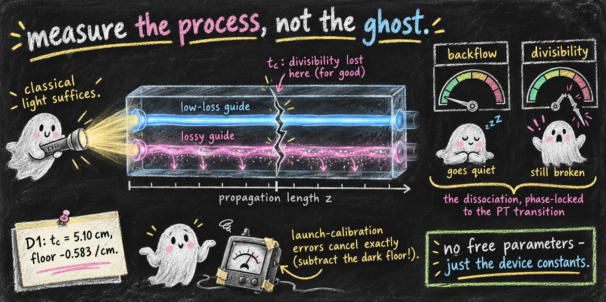
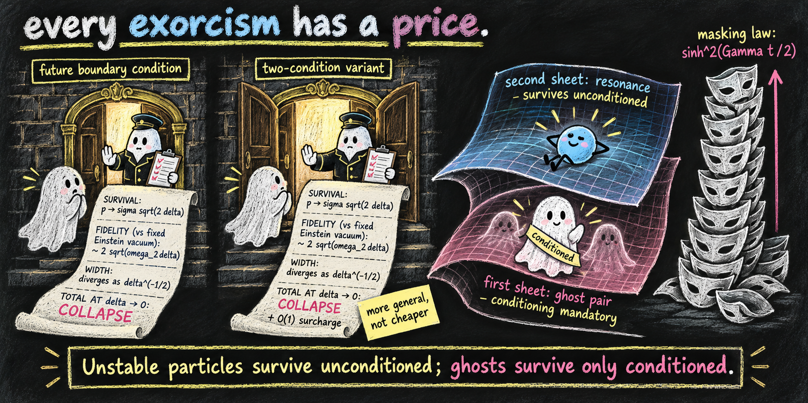
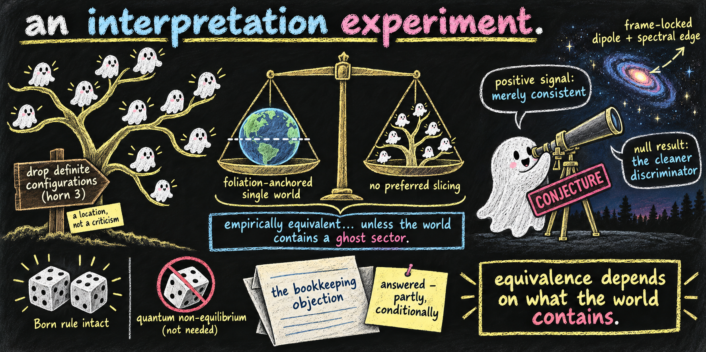
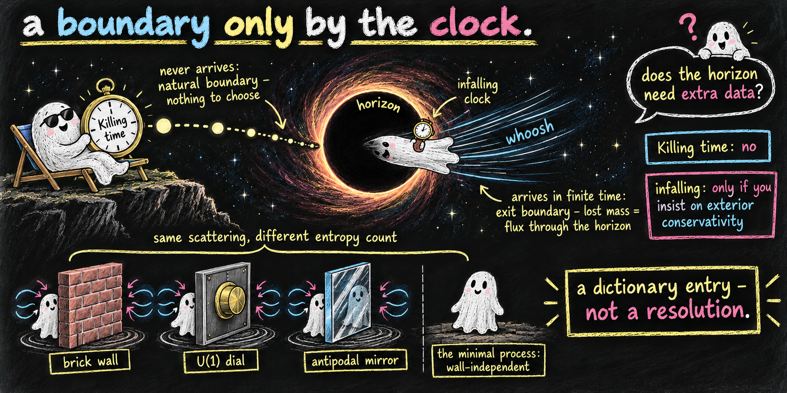

# The Indivisible Ghosts program

A research series connecting Jacob Barandes' reconstruction of quantum theory as *indivisible stochastic processes* with pseudo-Hermitian / PT-symmetric quantum mechanics and the ghost problem of higher-derivative theories. The papers form one ordered sequence: each cites only those before it.

> **Status: working drafts.** Every paper is under the program's release-gate audit and still being revised. None is peer reviewed.

The research was carried out by large language models (Claude, Anthropic), directed and reviewed by Jonathan Torkelson. Each paper's provenance statement says who did what; the audit process is in [`AUDIT.md`](AUDIT.md).

## The story in brief

Theories with *ghosts* (the negative-norm modes that plague higher-derivative attempts to quantize gravity) are usually dismissed as unphysical. Translated into the language of indivisible stochastic processes, their problems become precise and every way out becomes a priced choice. Each line below is held to the strength of its paper's abstract.

### 1. [Indivisible Ghosts](https://github.com/embeddetech/p01-indivisible-ghosts)

The ghost problem, recast as a question about random processes: does the process stay put, drift away, or *explode*, escaping its own state space in finite time?

### 2. [Measurable Ghosts](https://github.com/embeddetech/p02-measurable-ghosts)

Can any of this be seen on a lab bench? A proposed measurement on existing lossy photonic waveguide chips, using ordinary light and no free parameters.

### 3. [Instantaneous Ghosts](https://github.com/embeddetech/p03-instantaneous-ghosts)

When a ghost vacuum decays, *which "now"* does it decay in? A ghost sector would make an otherwise-hidden preferred slicing of spacetime observable, and the result is a trilemma: coupled ghosts, empirical Lorentz invariance, definite configurations. Any two, never all three (at tree level).

### 4. [Conditioned Ghosts](https://github.com/embeddetech/p04-conditioned-ghosts)

Conditioning on survival lets a lossy system appear to signal across an entangled pair. This paper prices that apparent signal with a sharp bound, which balanced gain/loss (PT) dynamics saturates exactly.

### 5. [Choosing Ghosts](https://github.com/embeddetech/p05-choosing-ghosts)

Conformal gravity must give up one horn of the trilemma, and its no-ghost quantization already has: it leaves no seat for definite configurations (at the linearized level).

### 6. [Unfolded Ghosts](https://github.com/embeddetech/p06-unfolded-ghosts)

Is the conformal point a resting place or a knife edge? It is a phase boundary: almost every unstructured perturbation tips it onto the growing side.

### 7. [Renormalized Ghosts](https://github.com/embeddetech/p07-renormalized-ghosts)

Does the channel-counting premise behind the trilemma survive a genuinely quantum field-theory calculation? An exact test says yes: the apparent deficit is textbook renormalization, not a new mechanism.

### 8. [Exorcised Ghosts](https://github.com/embeddetech/p08-exorcised-ghosts)

Every standard way of banishing ghosts, from Maldacena's boundary condition to propagator prescriptions, is survival conditioning in disguise or pays in another currency. The paper computes the bill.

### 9. [Many Ghosts](https://github.com/embeddetech/p09-many-ghosts)

Could ghosts tell interpretations of quantum mechanics apart? A conjecture: a coupled ghost sector would observationally separate foliation-anchored single-world readings from no-preferred-slicing ones like many-worlds, with the Born rule intact.

### 10. [Dilated Ghosts](https://github.com/embeddetech/p10-dilated-ghosts)

Is a black-hole horizon a boundary? It depends on whose clock you use. That is a new dictionary entry for the information paradox, not a resolution.

*Banner image: prompt written by Claude (Anthropic), rendered by ChatGPT (OpenAI).*

## The papers

| # | Paper | Read | Repository |
|---|---|---|---|
| 1 | *Indivisible stochastic processes for non-Hermitian and higher-derivative quantum systems*: detailed balance, broken PT symmetry, and the explosion of ghosts | [PDF](https://github.com/embeddetech/p01-indivisible-ghosts/blob/main/indivisible-ghosts-paper.pdf) | [p01-indivisible-ghosts](https://github.com/embeddetech/p01-indivisible-ghosts) |
| 2 | *Experimental proposal*: divisibility onset, generator floor, and the backflow–divisibility dissociation in a passive PT photonic coupler | [PDF](https://github.com/embeddetech/p02-measurable-ghosts/blob/main/measurable-ghosts-paper.pdf) | [p02-measurable-ghosts](https://github.com/embeddetech/p02-measurable-ghosts) |
| 3 | *Ghost vacuum decay as a stochastic process*: instantaneous states, the boost-orbit measure, and the foliation that ghosts make visible | [PDF](https://github.com/embeddetech/p03-instantaneous-ghosts/blob/main/instantaneous-ghosts-paper.pdf) | [p03-instantaneous-ghosts](https://github.com/embeddetech/p03-instantaneous-ghosts) |
| 4 | *The price of a post-selected signal*: a sharp survival–distinguishability trade-off, saturated by broken-PT dynamics | [PDF](https://github.com/embeddetech/p04-conditioned-ghosts/blob/main/conditioned-ghosts-paper.pdf) | [p04-conditioned-ghosts](https://github.com/embeddetech/p04-conditioned-ghosts) |
| 5 | *Conformal gravity must choose*: exceptional-point kinematics, vacuum decay, and the sample space of Weyl gravity | [PDF](https://github.com/embeddetech/p05-choosing-ghosts/blob/main/choosing-ghosts-paper.pdf) | [p05-choosing-ghosts](https://github.com/embeddetech/p05-choosing-ghosts) |
| 6 | *The conformal point is a phase boundary*: unfolding directions, the sign map of the cascade divisor, and a two-channel photonic readout | [PDF](https://github.com/embeddetech/p06-unfolded-ghosts/blob/main/unfolded-ghosts-paper.pdf) | [p06-unfolded-ghosts](https://github.com/embeddetech/p06-unfolded-ghosts) |
| 7 | *The multiplicity horn survives renormalization*: exact quantum evolution of a ghost–normal field theory, the folded channel sum, and an accumulated-truncation floor | [PDF](https://github.com/embeddetech/p07-renormalized-ghosts/blob/main/renormalized-ghosts-paper.pdf) | [p07-renormalized-ghosts](https://github.com/embeddetech/p07-renormalized-ghosts) |
| 8 | *Every exorcism has a price*: ghost removal as survival conditioning, from Maldacena's boundary condition to the pole sheet | [PDF](https://github.com/embeddetech/p08-exorcised-ghosts/blob/main/exorcised-ghosts-paper.pdf) | [p08-exorcised-ghosts](https://github.com/embeddetech/p08-exorcised-ghosts) |
| 9 | *Ghosts as an interpretation experiment*: what indivisible processes say to Everett | [PDF](https://github.com/embeddetech/p09-many-ghosts/blob/main/many-ghosts-paper.pdf) | [p09-many-ghosts](https://github.com/embeddetech/p09-many-ghosts) |
| 10 | *A boundary only by the clock*: the black-hole horizon between natural and exit, the membrane paradigm as the minimal semigroup, and the price of exterior unitarity | [PDF](https://github.com/embeddetech/p10-dilated-ghosts/blob/main/dilated-ghosts-paper.pdf) | [p10-dilated-ghosts](https://github.com/embeddetech/p10-dilated-ghosts) |

## What is here

| Path | Contents |
|---|---|
| [`papers/`](papers/) | Every paper's PDF, LaTeX source, scripts and archived outputs (an archive copy of each paper repository) |
| [`notes.md`](notes.md) | The full running research notebook |
| [`histories/`](histories/) | Audit ledgers: per-paper pass histories, the major- and minor-findings ledgers, the auditor-error log, the methodology timeline |
| [`research/`](research/) | Scoping reports and supporting calculations |
| [`TRILEMMA_REGISTRY.md`](TRILEMMA_REGISTRY.md) | Registry of the program's trilemma statements |
| [`CANONICAL_NUMBERING.md`](CANONICAL_NUMBERING.md) | Paper codenames, series numbers and repository names |
| [`Conversation_Conformal_Gravity_PT_Barandes.pdf`](Conversation_Conformal_Gravity_PT_Barandes.pdf) | The originating conversation |
| [`PT_stochastic_handoff.md`](PT_stochastic_handoff.md) | The project briefing that seeded paper 1 |

## License

MIT — see [`LICENSE`](LICENSE).
