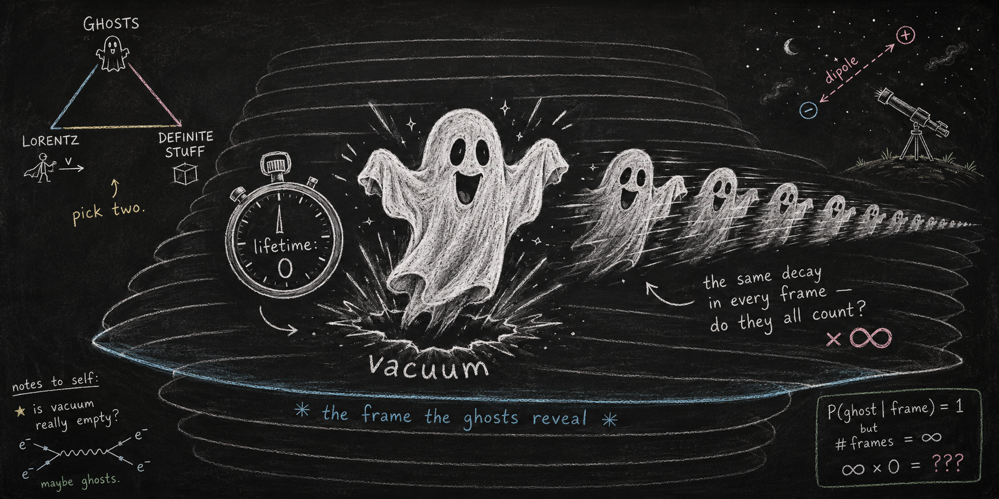

# Ghost vacuum decay as a stochastic process

*instantaneous states, the boost-orbit measure, and the foliation that ghosts make visible*



<sub>*Banner image: prompt written by Claude (Anthropic), rendered by ChatGPT (OpenAI).*</sub>

**Paper 3 of the [Indivisible Ghosts program](https://github.com/embeddetech/ghosts-program).** Jonathan Torkelson (2026).

**[Read the paper (PDF)](instantaneous-ghosts-paper.pdf)** · LaTeX source in [`paper/`](paper/)

> **Status: working draft.** This manuscript is under the program's release-gate audit and is still being revised. It has not been peer reviewed. Read it accordingly; corrections land here as they are made.

## Abstract

In a companion paper we showed that the Ostrogradski instability of interacting ghosts is, in the stochastic currency of Barandes’ quantum–stochastic correspondence, a recurrence-classification problem, with malicious interactions realizing *explosion*: escape from the sample space in finite time. Here we take the program to quantum field theory, where the vacuum of a ghost coupled to ordinary matter famously decays at a divergent rate. Our results: (i) the explosion dictionary acquires a Fock-space column—Feller’s *pure-birth* ladder criterion $`\sum_n 1/\lambda_n<\infty`$ is the discrete image of the classical time-of-flight integral, and finite-time blowup corresponds to ladder exponents $`\alpha_{\rm eff}>1`$, verified numerically (up to marginal logarithmic cases at $`\alpha_{\rm eff}=1`$); (ii) the known factorization of the ghost vacuum rate into an infinite boost-orbit volume times an invariant reduced integral (Gross–Strumia–Teresi–Zirilli) is verified by brute-force phase-space integration to $`0.1\%`$ in $`d{=}1`$, and yields the reduced measure’s dimension-and-coupling ladder ($`\Lambda^{0}/\Lambda^{4}/\Lambda^{8}`$), whose $`\Lambda^{8}/M_{\rm Pl}^{4}`$ rung reproduces the Cline–Jeon–Moore scaling; (iii) in Markov language the Lorentz-invariant *eternal* ghost vacuum is, on the multiplicity reading and at tree level, an *instantaneous state*—the minimal semigroup degenerates to zero vacuum lifetime—so a coupled ghost admits a non-degenerate configuration-space process only relative to a structure that individuates the channels—in every known rescue a frame or a birth surface—and every configuration-preserving rescue in the literature (momentum cutoffs, ghost condensation, a born vacuum) supplies one; (iv) classical lattice experiments in $`1{+}1`$ and $`2{+}1`$ dimensions show the classical decay tracks a different, *tadpole* dimension ladder ($`\langle \phi^2 \rangle\sim
k_{\max}^{d-1}`$, logarithmic at $`d{=}1`$), with the channel ladder flat to classical dynamics within the measurement resolution—spontaneous emission into empty channels is intrinsically quantum; (v) a beables-first field theory is foliation-anchored by construction, the foliation’s determinacy is a measurable property of the state that vanishes continuously at the vacuum, and a ghost sector would render the otherwise-hidden foliation observable (the hiddenness proved for the finite core; the ghost-induced observability argued at tree level); (vi) apparent superluminal signaling enters at the two points we identify (the conditioning point provably the unique marginal-breaker in the finite core, over the framework’s dilated local dynamics; the completions door left open), both simulated: survival conditioning (recovering the known resolution of the Lee–Hsieh–Flammia–Lee no-signaling controversy in one bookkeeping, with the signal magnitude of its broken-phase dimer analog now in closed form, $`\mathrm{TV}(\infty)=\tilde\kappa/\sin\theta`$) and conservative completions (a messaging protocol whose latency through infinity is distance-independent in the explosive class (in the cases tested), and which the minimal process silences). The findings assemble into a trilemma: *coupled ghosts, empirical Lorentz invariance, definite configurations—any two, never all three* (at tree level).

## Reproducing the results

Each script is standalone Python (NumPy/SciPy) and prints its controls inline. The paper's *Code availability* section maps scripts to results.

```
pip install numpy scipy
python scripts/foliation_m3.py
```

| Script |
|---|
| [`foliation_m3.py`](scripts/foliation_m3.py) |
| [`qft_bridge_closeout.py`](scripts/qft_bridge_closeout.py) |
| [`qft_bridge_decomp.py`](scripts/qft_bridge_decomp.py) |
| [`qft_bridge_e4_2d.py`](scripts/qft_bridge_e4_2d.py) |
| [`qft_bridge_stage2.py`](scripts/qft_bridge_stage2.py) |
| [`qft_bridge_stage3.py`](scripts/qft_bridge_stage3.py) |
| [`s1_no_signaling.py`](scripts/s1_no_signaling.py) |
| [`s2_infinity_channel.py`](scripts/s2_infinity_channel.py) |
| [`s2b_dirichlet.py`](scripts/s2b_dirichlet.py) |
| [`s3_foliation_determinacy.py`](scripts/s3_foliation_determinacy.py) |
| [`s4a_books_balance.py`](scripts/s4a_books_balance.py) |
| [`s4b_horn3_silence.py`](scripts/s4b_horn3_silence.py) |
| [`s4c_dipole_template.py`](scripts/s4c_dipole_template.py) |
| [`s4d_cosi_forecast.py`](scripts/s4d_cosi_forecast.py) |
| [`s5_state_divergence.py`](scripts/s5_state_divergence.py) |

## Audit trail and provenance

This manuscript is an experiment in AI-conducted research: the work was carried out by large language models (Claude, Anthropic), directed and reviewed by the author. The paper's provenance statement says who did what. Nothing here should be taken on trust.

- The audit process: [`AUDIT.md`](AUDIT.md)
- Pass-by-pass audit ledger: [`histories/paper3-history.md`](histories/paper3-history.md)
- The lab-notebook entries for this paper: [`notes-excerpt.md`](notes-excerpt.md)
- The full research notebook, the originating conversation, and every companion paper: the [program hub](https://github.com/embeddetech/ghosts-program)

## License

MIT — see [`LICENSE`](LICENSE).
