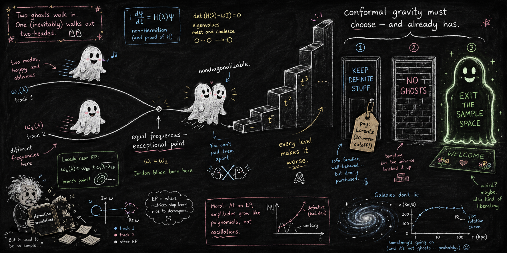

# Conformal gravity must choose

*exceptional-point kinematics, vacuum decay, and the sample space of Weyl gravity*



<sub>*Banner image: prompt written by Claude (Anthropic), rendered by ChatGPT (OpenAI).*</sub>

**Paper 5 of the [Indivisible Ghosts program](https://github.com/embeddetech/ghosts-program).** Jonathan Torkelson (2026).

**[Read the paper (PDF)](choosing-ghosts-paper.pdf)** · LaTeX source in [`paper/`](paper/)

> **Status: working draft.** This manuscript is under the program's release-gate audit and is still being revised. It has not been peer reviewed. Read it accordingly; corrections land here as they are made.

## Abstract

Mannheim’s conformal (Weyl) gravity is the flagship application of the $`\mathcal{PT}`$/antilinearity program, and its quantum-mechanical prototype is the Pais–Uhlenbeck oscillator at *equal frequencies*: the $`1/k^{4}`$ propagator is, mode by mode, the degenerate limit of two opposite-residue poles—a Jordan block. We analyze the theory in the stochastic currency of the preceding papers of this series, with four results. (i) *Kinematics*: every linearized spin-2 field mode ($`k>0`$) of conformal gravity sits exactly at an exceptional point of the similarity dictionary, whose per-mode cost we lower-bound for every normal-target (mode-built) dictionary (up to an $`O(1)`$ factor, the EP-driven $`\mathrm{cond}\to2/|\delta|`$ at $`\omega=1`$, following the relative detuning $`\delta/\omega`$ along a dispersion; massive quadratic gravity approaches the exceptional line in the ultraviolet with EP-driven cost growing as $`k^{2}`$), while the Hermitian ghost realization passes through the point exactly unitarily. (ii) *A no-representation lemma*: a real-eigenvalue Jordan-block Hamiltonian (finitely many configurations) admits *no* closed stochastic-process representation under any similarity whatsoever—the obstruction at the conformal point is structural, not a diverging cost—and the lemma lifts to the free field level: the $`M`$-quantum sector of a conformal mode carries a single Jordan block of size $`M{+}1`$ (secular growth $`t^{M}`$, the constructive form of Smilga’s infinite-order exceptional point), and no metric that is bounded with bounded inverse in the occupation-number Fock norm yields a stochastic representation on a conformal mode’s Fock tower. This, we argue, recasts the published Bender–Mannheim/Smilga dispute: “unitarity is broken” is the closed-currency statement, while unitary evolution via nonstationary states we read, in this currency, as the survival-conditioned bookkeeping of the dilation—an open-system reading. The dipole ghost’s open process is a one-way cascade whose indivisibility enters, at the mechanical cell, through conditional mass creation—a mechanism new to the taxonomy (the higher Fock sectors add ordinary divisor negativity—a convention-independent sign; the mass-creation reading is stated relative to the minimal survival-conditioning convention, whose definition and justification the text makes explicit). (iii) *Vacuum decay*: at the scale-invariant ($`\delta=0`$) point the ghost sector’s golden-rule rate sits on the contact (s-flat) rung of the dimension ladder, $`\Gamma/V\sim\Lambda^{4}/\alpha_g^{2}`$—a maximally generous lower bound, since consistently regulating the split poles ($`\delta>0`$) only raises it (for modes of relative detuning $`\ll1`$)—with a dimensionless coupling in place of the Planck suppression; pricing the Lorentz-violating-cutoff rescue then forks on $`\alpha_g`$—the face-value rotation-curve matching ($`|\alpha_g|\sim3\times10^{109}`$) makes the bound vacuous but that branch fails solar-system tests on published (Mannheim-disputed) analyses, while an unfixed $`\alpha_g`$ within eight decades of unity (a conservative figure) forces the cutoff to macroscopic wavelengths; the larger-coupling ray is closed on the face-value branch by point-collapse—every leading-order gravitational (one-exchange) tree observable scales as $`1/\alpha_g`$, so the fit pins $`\alpha_g`$ to a single, solar-system-dead value—and on Mannheim’s branch by an explicit naturalness prior, stated as such. (iv) *The trilemma closes*: coupled ghosts, empirical Lorentz invariance, definite configurations—pick two (at tree level). Conformal gravity’s no-ghost quantization has already picked: at the exceptional point its Jordan dynamics admits no *closed* definite-configurations seat within the stated dictionary classes—a free/linearized-level statement—so that program is born on the exit-the-sample-space horn, while the Hermitian ghost realization keeps configurations at precisely horn 1’s price; we price both seats. The *adjudicated* escape routes map onto the horns (one horn-adjacent, one premise-disputing; the recent 2024–2026 entries, the older alternative quantizations, and the Bohmian route remain pending).

## Reproducing the results

Each script is standalone Python (NumPy/SciPy) and prints its controls inline. The paper's *Code availability* section maps scripts to results.

```
pip install numpy scipy
python scripts/t4_ep_dictionary.py
```

| Script |
|---|
| [`t4_ep_dictionary.py`](scripts/t4_ep_dictionary.py) |
| [`t4_jordan_process.py`](scripts/t4_jordan_process.py) |
| [`t4_rate_ladder.py`](scripts/t4_rate_ladder.py) |
| [`t4_sector_tower.py`](scripts/t4_sector_tower.py) |
| [`t4_tower_similarity.py`](scripts/t4_tower_similarity.py) |

## Audit trail and provenance

This manuscript is an experiment in AI-conducted research: the work was carried out by large language models (Claude, Anthropic), directed and reviewed by the author. The paper's provenance statement says who did what. Nothing here should be taken on trust.

- The audit process: [`AUDIT.md`](AUDIT.md)
- Pass-by-pass audit ledger: [`histories/paper5-history.md`](histories/paper5-history.md)
- The full research notebook, the originating conversation, and every companion paper: the [program hub](https://github.com/embeddetech/ghosts-program)

## License

MIT — see [`LICENSE`](LICENSE).
